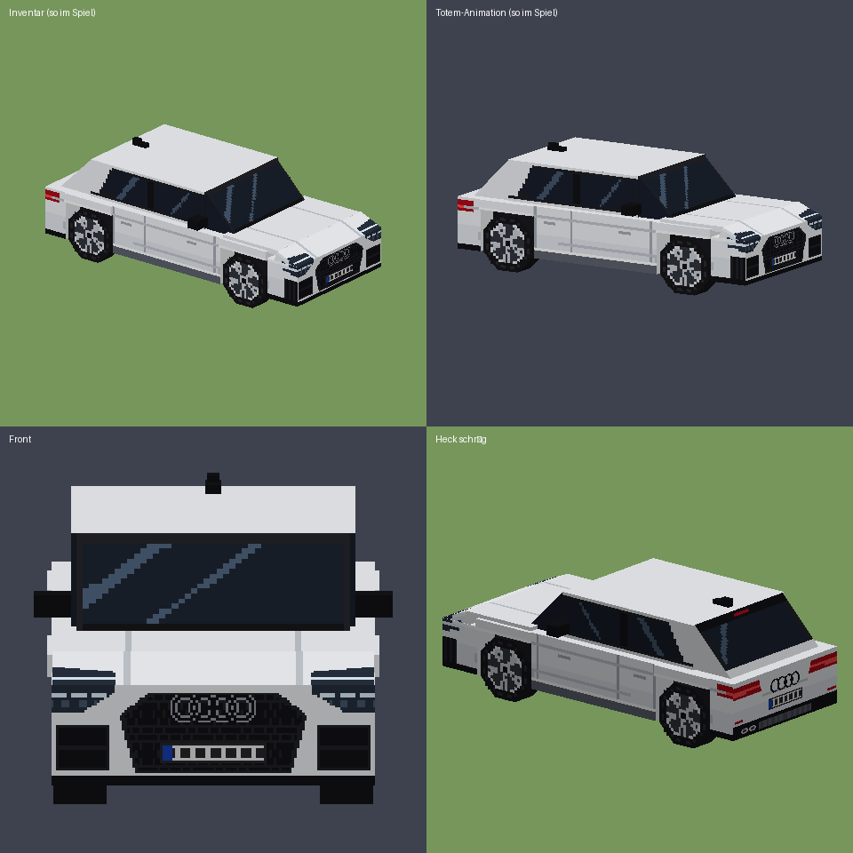

# Audi A3 Totem (Resourcepack, Minecraft 1.18.2)

Ersetzt das Totem der Unsterblichkeit durch ein **3D-Modell** eines weißen Audi A3 Sportback
S line (2017) mit silbernen Felgen und schwarzen Details (Ringe, Grill, Spiegel, Fensterleisten).
Ein Resourcepack wirkt nur bei dir: andere Spieler sehen weiterhin das normale Totem.



## Installation (CurseForge)

1. `Audi-A3-Totem.zip` herunterladen (nicht entpacken).
2. Profil → `…` → **Open Folder** → Datei in den Ordner `resourcepacks` legen.
3. Im Spiel: Optionen → Ressourcenpakete → „Audi A3 S line Totem“ nach rechts schieben → Fertig.

## Selbst neu bauen

```
cd minecraft-resourcepack/tools
python3 build_model.py ../pack          # Modell + Textur erzeugen
python3 preview.py ../pack ../vorschau.png
cd ../pack && zip -r ../Audi-A3-Totem.zip pack.mcmeta pack.png assets
```
